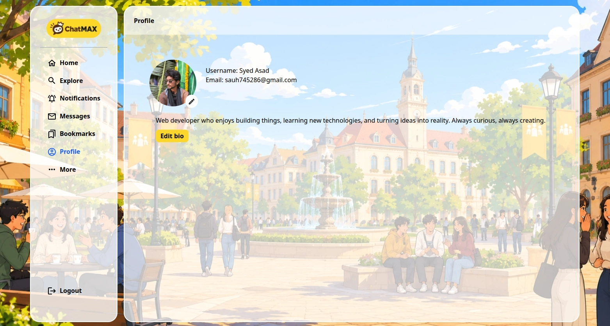
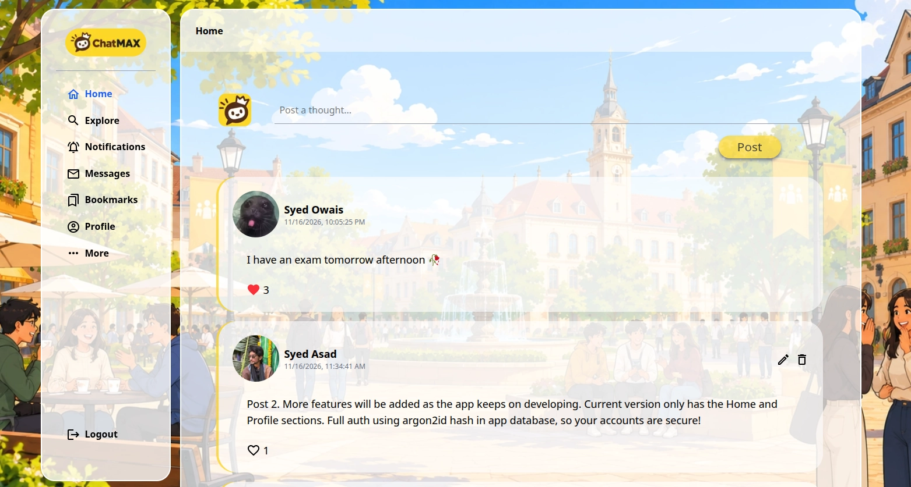

# ChatMAX

A full-stack social media application built with **Next.js, React, TypeScript, and PostgreSQL**. ChatMAX allows users to create accounts, share posts, interact with content, and manage their profiles.

## Screenshots

### Home Page



### Profile Page



## Features

- User authentication and session management
- Create, edit, and delete posts
- Like and interact with posts
- User profiles with profile pictures
- Profile information and bio management
- Responsive user interface

## Tech Stack

- **Frontend:** Next.js, React, TypeScript, Tailwind CSS
- **State Management:** Redux Toolkit
- **UI Components:** Material UI
- **Backend:** Next.js API Routes
- **Database:** PostgreSQL
- **Authentication:** Database-backed sessions and HTTP-only cookies

## Getting Started

```bash
git clone https://github.com/Syed-Asad-745/social-media-app.git

cd social-media-app

npm install

npm run dev
```

Create a `.env` file with the required environment variables before running the application.

## Author

**Asad**

[GitHub](https://github.com/Syed-Asad-745)